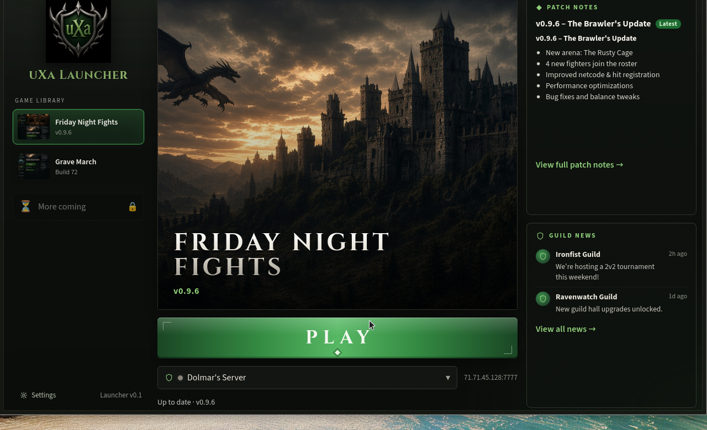
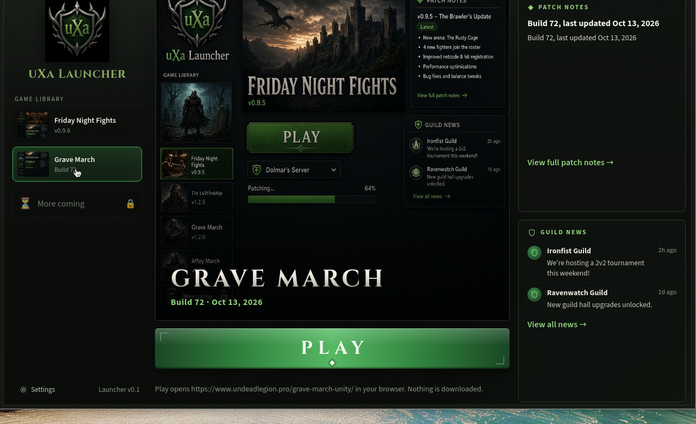
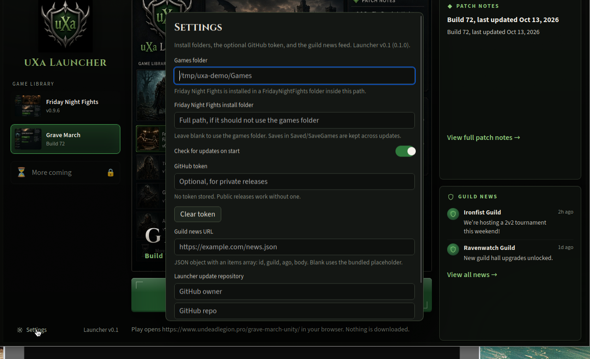
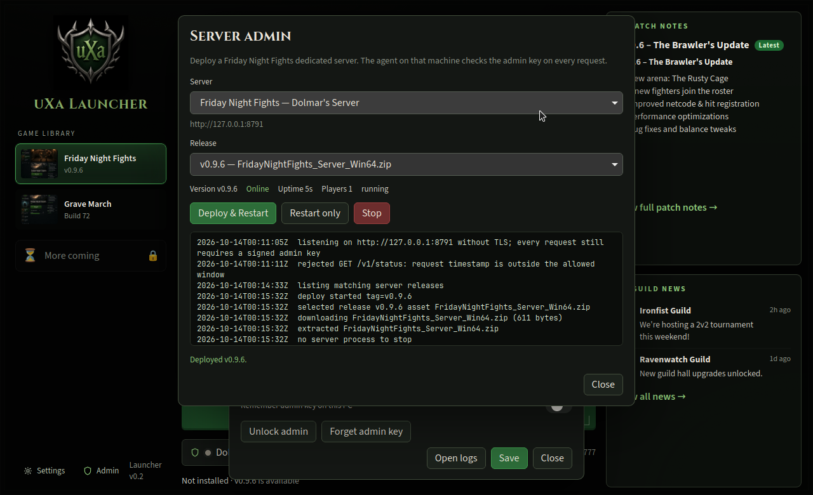

# uXa Launcher

Desktop launcher for the uXa gaming guild, version **0.3.1**. It installs and patches Windows games, keeps player saves across updates, and opens browser games. Admins can also deploy the Friday Night Fights dedicated server. Launcher versions are not game versions.









## What it does

- **Game library** from `config/games.json`, so another game is a config change.
- **Friday Night Fights** (Unreal Engine client): finds the newest GitHub release of `uXa-Sloppy/FridayNightFights`, including pre-releases, and downloads the zip whose name contains `Client` and `Win64`. That filter is `assetContains` / `assetPattern` in the config.
- **Patching** compares the local manifest with the release tag. The download shows progress, can resume, and is checked (size, zip structure, and the GitHub `sha256` digest when the API sends one). The zip is extracted beside the install and swapped into place. If the swap fails, the previous install is put back.
- **Saves and config** listed in `preserve` (by default `Saved/SaveGames` and `Saved/Config`) are copied onto the new build before the swap.
- **Play** is disabled while the launcher is checking or patching. It is **Install** or **Update** when a build is needed, and green **Play** when the install matches the release. If GitHub cannot be reached but a copy is already installed, Play stays available.
- **Server.** `config/servers.json` lists servers. Dolmar's Server (`71.71.45.128:7777`) is the default, plus Localhost. Play launches `FridayNightFights.exe` with `host:port` as the first argument and writes `Config/Servers.ini` as `Name | Host | Port` lines. A small dot is a best-effort TCP probe; the game itself uses UDP, so "unknown" does not mean the server is down.
- **Grave March** opens `https://www.undeadlegion.pro/grave-march-unity/` in the default browser. The version line is read from that page (`Build 72, last updated Oct 13, 2026`). If the page cannot be read, Play still works.
- **Patch notes** render the GitHub release body (or Grave March's build line). **Guild news** loads a `news.json` URL from Settings, and falls back to the bundled feed.
- **Settings** cover the games folder, a per-game install path, an optional GitHub token, update checks on startup, the news URL, and the launcher's own update repository. On Windows the token is stored in Credential Manager; otherwise it is a user-only file. It is never written into `settings.json`.
- **Launcher updates.** With **Check for updates on start** on, startup looks at the latest GitHub release of `uXa-Sloppy/uXa-Launcher` (Settings can override the owner and repo). A newer release downloads `uxa-launcher.exe`, checks its size and the `SHA256SUMS.txt` entry, then on Windows renames the running exe to `uxa-launcher.exe.old`, puts the new file in its place, and restarts. The next start deletes the `.old` file. Settings stay in `%LOCALAPPDATA%\uXa\Launcher` (including a `servers.json` override). If the download, checksum, or swap fails, the previous exe is left running. A saved GitHub token is sent only when that repository is private, and it is never written to the log.
- **Logs** go to `%LOCALAPPDATA%\uXa\Launcher\logs` on Windows (`~/.local/share/uXa/Launcher/logs` on Linux).
- **Admin** is hidden until an admin key is accepted by a server agent. From there an admin can deploy a dedicated-server build, restart it, or stop it. The key is never written into `settings.json`.

Out of scope: an intro video, accounts, and login. This repo does not modify Friday Night Fights.

## Command line

The same `uxa-launcher.exe` accepts commands so a shell can deploy and patch without opening the window. On Windows the installed copy is `%LOCALAPPDATA%\uXa Launcher\uxa-launcher.exe`. These commands still run when the window is already open. They print plain progress to the console and return exit code 0 on success. A failure returns 1. An unknown flag returns 2.

Release builds are Windows GUI programs, so a double-clicked launch has no console. A command run from PowerShell or `cmd` attaches to that console; if there is no parent console, one is allocated. Redirected stdout and stderr (`> file`, `|`, and `2>`) are left alone, so a script can capture them. `AttachConsole` on 0.3.3 replaced those redirected handles and the text was written nowhere: `--version` and `--status` exited 0 with empty stdout, empty stderr, and no log line.

Every command also writes `%LOCALAPPDATA%\uXa Launcher\cli-last.json`. `UXA_CLI_RESULT` overrides that path. The file is replaced atomically and is the stable result for automation:

```json
{
  "command": "--status",
  "ok": true,
  "message": "Launcher: 0.3.3\nClient: not installed\nServer: Dolmar's Server\nServer version: v0.9.7.2\nServer online: yes",
  "versions": { "launcher": "0.3.3", "client": null, "server": "v0.9.7.2" },
  "timestamp": "2026-10-17T03:00:00Z",
  "exitCode": 0
}
```

`ok` is true only when `exitCode` is 0. `versions.client` and `versions.server` are null when that command did not learn them. The same line is appended to the launcher log under `%LOCALAPPDATA%\uXa\Launcher\logs`. The admin key and GitHub token are never written into the file or the log.

```powershell
& "$env:LOCALAPPDATA\uXa Launcher\uxa-launcher.exe" --status
& "$env:LOCALAPPDATA\uXa Launcher\uxa-launcher.exe" --update-client
& "$env:LOCALAPPDATA\uXa Launcher\uxa-launcher.exe" --deploy-server v1.2.0
& "$env:LOCALAPPDATA\uXa Launcher\uxa-launcher.exe" --version
& "$env:LOCALAPPDATA\uXa Launcher\uxa-launcher.exe" --help
```

- `--status` prints the launcher version, the installed Friday Night Fights client version, and the selected server's version and whether it is online. Those three versions are also `versions` in `cli-last.json`.
- `--update-client` downloads and installs the latest Friday Night Fights client patch, the same way Play's patch step does, and does not start the game. It prints the installed version.
- `--deploy-server <version>` deploys that server release tag to the selected server (Dolmar's Server unless Settings names another) through the uXa Server Agent. It waits until the agent finishes, then prints the agent's result and the running version.
- With no flags, the launcher window opens.

The server list is `config/servers.json`, or `%LOCALAPPDATA%\uXa\Launcher\servers.json` when that file is present (the same override the window uses, including a Cloudflare tunnel `agentUrl`). Deploy and status use the admin key already saved by unlocking admin in the window. They never print, log, or rewrite that key, a GitHub token, or `settings.json`. If the key is not saved yet, the command stops and asks you to unlock admin once in the window.

Installing 0.3.1 over an older copy, or letting the launcher replace its own exe, updates `%LOCALAPPDATA%\uXa Launcher\uxa-launcher.exe` only. Settings, `servers.json`, the admin key, and the GitHub token stay in `%LOCALAPPDATA%\uXa\Launcher`.

## Server admin

The launcher does not copy files onto the game machine itself. A small **uXa Server Agent** runs on that machine (for Dolmar, `71.71.45.128`) and the launcher sends it signed requests.

The agent listens on its own port (default `8788`) and does four things when asked to deploy:

1. Download the zip whose name contains `Server` and `Win64` from the selected GitHub release of `uXa-Sloppy/FridayNightFights`.
2. Warn the running `FridayNightFightsServer` on stdin (`say`, then `quit`), then copy `Saved` to a timestamped backup.
3. Swap the new build into place and keep `Saved` and `Config`.
4. Start it with the configured arguments and `-port=7777`, wait until the process is still running, and put the previous build back if it exits.

The agent also does this by itself. With `autoUpdate` left at its defaults it checks GitHub about 30 seconds after it starts, then every 6 hours. A newer dedicated-server zip is downloaded and unpacked under the work directory. The running server is not stopped for that check. The game server is restarted only inside a daily window, default `03:00` in `America/New_York` (US Eastern, including daylight saving) and only for 10 minutes after that time. If a build is staged, that restart installs it. If nothing is staged, the server still restarts once that day so the host comes back clean. A boot later in the morning does not catch up. The agent executable may replace itself at a check; that restart does not send `quit` to the game server.

`Saved` is copied to a timestamped folder before an install or the daily restart. The last 7 copies are kept (`keepBackups`, and `0` keeps every copy). A `Saved` folder inside the downloaded zip is discarded when the live install has one, including `<Project>/Saved`. If the new build dies during the health wait, the previous install is put back and the timestamped `Saved` copy is restored over it. The live `Saved` directory is not deleted to make room for the zip.

Version tags with two, three, or four numeric parts are ordered numerically. `v0.9.7.2` and `v0.9.7.2-build18g` are both newer than `0.9.6` and `0.9.6.1`. The same numbers without a suffix are newer than that suffix. Scheduled checks pick the highest version, not whichever release GitHub listed first. Launcher release checks use the same comparison.

```json
"autoUpdate": {
  "enabled": true,
  "intervalHours": 6,
  "checkAfterStartSecs": 30,
  "checkTimes": [],
  "serverEnabled": true,
  "agentEnabled": true,
  "agentOwner": "uXa-Sloppy",
  "agentRepo": "uXa-Launcher",
  "agentAsset": "uxa-server-agent.exe",
  "restartTime": "03:00",
  "restartTimeZone": "America/New_York",
  "restartWindowMinutes": 10,
  "dailyRestart": true,
  "keepBackups": 7,
  "graceSeconds": 180
}
```

`checkTimes` are extra check clocks in `restartTimeZone`. They do not restart the server. `graceSeconds` is how long a restart waits when `Saved/uxa-status.json` says players are online. An unknown player count uses `warnSeconds` instead. The agent release is the public `uXa-Sloppy/uXa-Launcher` latest stable build; `UXA_GITHUB_TOKEN` is sent only if the anonymous request fails. `FNF` release checks keep using that token when it is already configured, because that repo may be private. Nothing in `agent.json` may be named secret or token.

Each check and install is appended to `updates.log` in the log directory and to the admin log. Status adds `agentVersion`, `lastCheckAt`, `lastCheckResult`, `lastUpdateAt`, `lastUpdateResult`, `stagedVersion`, and `nextRestartAt`. A manual Deploy still installs immediately. Set `enabled` to false to keep the scheduler off.

Every request carries `X-Uxa-Timestamp` and `X-Uxa-Signature`, an HMAC-SHA256 of `{unix_seconds}\n{METHOD}\n{path}\n{sha256(body)}`. The timestamp must be within five minutes. Set `tlsCert` and `tlsKey` in `agent.json` to serve HTTPS with those same signatures. Without a certificate the listener is HTTP, which is what the local mock uses; put a real certificate on a machine that faces the network, or terminate TLS in front of it. The launcher trusts the system certificate store.

There is no built-in admin key. The agent reads, in order, `UXA_AGENT_SECRET`, `UXA_AGENT_SECRET_FILE`, then `agent.secret` next to the executable or the config. A GitHub token, if the releases are private, is `UXA_GITHUB_TOKEN` only. If `agent.json` contains a secret or token field, the agent refuses to start. `config/agent.example.json` is the shape of that file.

`config/servers.json` points Dolmar's Server at `https://71.71.45.128:8788`. That address is not a secret. `UXA_AGENT_URL` overrides every server's agent address for a local test.

In the launcher, Settings has an admin key field. Unlock asks the agent for status. A 401 stays locked and shows no Admin section. Remembering the key stores it in Windows Credential Manager, or in a user-only `agent-secret` file otherwise. After it unlocks, Admin shows the server, the matching releases, Deploy & Restart, Restart only, Stop, a confirm step, and a live log with version, online, uptime, and player count. A second line shows the agent build, the last check, the last update, the staged server version, and the next restart time. Player count is read from `Saved/uxa-status.json` when the server writes one; otherwise it stays unknown.

### Install the agent on Windows

On the game server, from an elevated PowerShell, after `cargo build -p uxa-server-agent --release` (or after downloading the `uxa-server-agent-windows` workflow artifact):

```powershell
$env:UXA_AGENT_SECRET = "paste-the-guild-key"
powershell -ExecutionPolicy Bypass -File scripts\install-server-agent.ps1
```

Edit `C:\uXa\ServerAgent\agent.json` so `installDir` is the dedicated server folder, then `sc start uXaServerAgent`. The service name is `uXaServerAgent`. `agent.secret` is readable by SYSTEM and Administrators only. Foreground debugging, without the service, is `uxa-server-agent.exe` in that folder with the same variables.

Generate a certificate the launcher will trust, set `tlsCert` and `tlsKey`, and restart the service before pointing the launcher at `https://`. The game port stays `7777`. The agent port stays separate.

### Try a deploy against the mock

The Rust test `deploy_preserves_saves_and_rolls_back` does this without the UI: a local GitHub stand-in serves a good server zip and a zip that exits immediately, and the agent must keep `Saved`, broadcast `say` then `quit`, and restore the good build.

To click through it, serve the mock (it now includes a real `Server` + `Win64` zip), point an agent at it, and override the launcher:

```bash
python3 scripts/mock_release_server.py --port 8899
UXA_AGENT_SECRET=dev-admin-key \
UXA_AGENT_CONFIG=/tmp/uxa-agent.json \
UXA_GITHUB_API_BASE=http://127.0.0.1:8899 \
  cargo run -p uxa-server-agent
```

`/tmp/uxa-agent.json` needs `installDir`, `listen` (for example `127.0.0.1:8791`), `apiBase` set to the mock, `warnSeconds` of `0` if you do not want to wait, and no secret field. Then:

```bash
UXA_AGENT_URL=http://127.0.0.1:8791 \
UXA_GITHUB_API_BASE=http://127.0.0.1:8899 \
UXA_DATA_DIR=/tmp/uxa-demo \
UXA_INSTALL_ROOT=/tmp/uxa-demo/Games \
  npm run tauri dev
```

Unlock with `dev-admin-key`. Deploy & Restart. The agent log should show the download, the save backup, and a healthy process. Stop shuts it down. A build that exits during the health wait is rolled back; that path is what the automated test forces.

## Layout on disk

| | Windows | Linux dev |
| --- | --- | --- |
| Launcher data | `%LOCALAPPDATA%\uXa\Launcher` | `~/.local/share/uXa/Launcher` |
| Games | `%LOCALAPPDATA%\uXa\Games\FridayNightFights` | `~/.local/share/uXa/Games/FridayNightFights` |

Override either location with `UXA_DATA_DIR` and `UXA_INSTALL_ROOT`. A `games.json`, `servers.json`, or `news.json` placed in the launcher data directory replaces the copy shipped with the app.

Private releases: add a GitHub token with access to read release contents. Public releases need no token. `UXA_GITHUB_API_BASE` points the client at another host (used by the mock server below).

## Develop

Requirements: Node.js 22+, Rust stable, and on Linux the WebKitGTK 4.1 development packages Tauri documents.

```bash
npm install
npm test          # patch, resume, save preservation, launch arguments
npm run tauri dev
```

The dev window talks to `http://127.0.0.1:1420`. Opening that address in a normal browser shows the same interface without the desktop commands.

### Try a patch without the private repo

`uXa-Sloppy/FridayNightFights` is not visible without a token. A local stand-in serves the releases API and a client zip:

```bash
python3 scripts/mock_release_server.py --port 8899
UXA_GITHUB_API_BASE=http://127.0.0.1:8899 \
UXA_DATA_DIR=/tmp/uxa-demo \
UXA_INSTALL_ROOT=/tmp/uxa-demo/Games \
npm run tauri dev
```

Install from the launcher, put a file in `Saved/SaveGames`, change the tag in `.uxa-dev/mock-version.txt`, and restart. The new build replaces the old one and the save is still there. Play writes `Config/Servers.ini` and starts `FridayNightFights.exe` with the selected `host:port`.

## Windows build

The installer is an NSIS setup (current user, no admin). It installs to `%LOCALAPPDATA%\uXa Launcher\uxa-launcher.exe` and bootstraps WebView2 if Windows does not already have it.

On a Windows machine, from this directory:

```powershell
powershell -ExecutionPolicy Bypass -File scripts/build-windows.ps1
```

The setup executable is written to `src-tauri\target\release\bundle\nsis\`.

You need Node.js 22+, Rust stable, and the Visual Studio C++ build tools. WebView2 is already present on current Windows 11 images and on GitHub-hosted runners.

Pushing `main`, pushing a `v*` tag, or running the workflow by hand runs `.github/workflows/windows-build.yml`. It uses Rust **1.99.0** and uploads `uxa-launcher.exe`, the NSIS installer, and `SHA256SUMS.txt` as the `uxa-launcher-windows` artifact. A version tag or a manual run also attaches those files to a GitHub Release. `scripts/build-windows.sh` runs the same tests on Linux and prints these steps; it does not cross-compile the installer.

## Tests

`npm test` runs `cargo test -p launcher-core -p uxa-server-agent`. The launcher tests cover:

- choosing the `Client` + `Win64` zip and ignoring server/Linux assets
- semver comparison of release tags, including four-part versions and suffixes such as `v0.9.7.2-build18g`
- the server agent staging an update without stopping the process, installing it only from `apply_maintenance`, and restoring `Saved` when that build exits
- resume via HTTP Range
- rejecting zip paths that escape the install directory
- a failed archive leaving the existing install untouched
- an update that keeps `Saved/SaveGames` and `Saved/Config`, drops other old files, and swaps the folder
- `Config/Servers.ini` format and `FridayNightFights.exe host:port`
- Grave March's build line, including a dead page that still allows play
- a private-repo 404 that leaves an installed game playable
- `--status`, `--update-client`, and `--deploy-server` leave `settings.json`, `servers.json`, the admin key, and the GitHub token byte-for-byte unchanged
- a CLI result file records `command`, `ok`, `message`, `versions`, `timestamp`, and `exitCode`, redacts a GitHub token, and a redirected stdout handle is not replaced by the console attach
- a launcher self-update, and a second install over the top of that exe, leave those same files unchanged

The server-agent test deploys a mock `Server` + `Win64` zip, keeps `Saved` and `Config`, records the warning and `quit`, rejects a bad signature, rolls back a build that exits immediately, then restarts and stops the restored process. A config file that contains a secret is refused.

## Config

`config/games.json` is the catalog. Friday Night Fights:

```json
"assetContains": ["Client", "Win64"],
"assetPattern": "",
"includePrereleases": true,
"preserve": ["Saved/SaveGames", "Saved/Config"]
```

`assetPattern` is an optional regex applied in addition to `assetContains`. Assets must be `.zip` files. `config/servers.json` is the server list. An optional `agentUrl` is the uXa Server Agent for that host. The dedicated server build is chosen with `Server` and `Win64`, which is separate from the client filter above. `config/agent.example.json` is the agent config, without a key.
